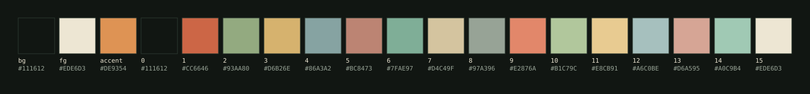

<div align="center">

# sanctuary

Arch · Hyprland (Lua) · [takt](https://github.com/OtoYuki/takt) · kitty · zsh · yazi · rofi



</div>

```console
$ bash <(curl -fsSL https://raw.githubusercontent.com/OtoYuki/dotfiles/main/.config/dotfiles/install.sh)
```

Bare repo at `~/.cfg`, work tree `~`. Existing files are moved to `~/.dotfiles-backup/<timestamp>/` before checkout. Re-running updates in place.

| flag | |
|---|---|
| `--no-packages` | dotfiles only, no pacman / AUR |
| `--no-takt` | skip the takt build, waybar is the bar |
| `--host NAME` | force a host profile, or `none` |
| `--dry-run` | print, change nothing |
| `-y` | no prompt |

Packages: [`pacman.txt`](../.config/dotfiles/packages/pacman.txt) · [`aur.txt`](../.config/dotfiles/packages/aur.txt). AUR helper: paru or yay, `yay-bin` is bootstrapped if neither exists.

```console
$ config status          # alias config='git --git-dir=$HOME/.cfg --work-tree=$HOME'
$ config pull
```

## stack

| | | config |
|---|---|---|
| compositor | Hyprland, Lua config | [`.config/hypr/hyprland.lua`](../.config/hypr/hyprland.lua) |
| session | uwsm | [`.config/uwsm`](../.config/uwsm) |
| bar | takt (Rust, GTK4 layer shell) · waybar fallback | [`.config/waybar`](../.config/waybar) |
| lock / idle | hyprlock · hypridle | [`.config/hypr/hyprlock.conf`](../.config/hypr/hyprlock.conf) |
| terminal | kitty, GeistMono Nerd Font | [`.config/kitty`](../.config/kitty) |
| shell | zsh · oh-my-posh · zoxide · fzf · eza · bat | [`.zshrc`](../.zshrc) · [`.config/oh-my-posh`](../.config/oh-my-posh) |
| files | yazi, `sanctuary` flavor | [`.config/yazi`](../.config/yazi) |
| launcher | rofi | [`.config/rofi`](../.config/rofi) |
| notifications | swaync | [`.config/swaync`](../.config/swaync) |
| wallpaper | awww · wallust | [`.config/wallust`](../.config/wallust) · [`Pictures/wallpapers`](../Pictures/wallpapers) |
| clipboard | cliphist + rofi | [`.config/hypr/scripts/cliphist-rofi.sh`](../.config/hypr/scripts/cliphist-rofi.sh) |
| audio | PipeWire · WirePlumber filter graphs | [`.config/wireplumber`](../.config/wireplumber) |
| runtimes | mise | [`.config/mise`](../.config/mise) |

## keys

`SUPER` = mod

| | |
|---|---|
| `mod Return` | kitty |
| `alt Space` | rofi |
| `mod E` | yazi |
| `mod Q` | close |
| `mod V` · `mod P` · `mod J` | float · pseudo · split |
| `mod ←↑↓→` | focus |
| `mod 1-0` · `mod shift 1-0` | workspace · move to workspace |
| `mod ctrl ←→` | previous / next workspace |
| `mod S` · `mod shift S` | scratchpad · move to scratchpad |
| `mod LMB` · `mod RMB` | move · resize |
| `mod C` | clipboard history |
| `mod shift C` · `mod alt C` · `mod ctrl C` | screenshot region · output · window |
| `mod alt W` | next wallpaper + recolour |
| `mod B` / `mod T` | toggle takt |
| ``mod ` `` · ``mod shift ` `` | takt screen next / prev |
| `mod L` | lock |
| `mod M` | power menu |
| `mod shift O` · `mod alt O` | screens on · off |
| `mod F5` / `mod F6` | brightness |
| `mod alt F5` / `mod alt F6` | external monitor brightness (DDC/CI) |

## theme

`mod alt W` cycles `~/Pictures/wallpapers`. A wallpaper with a matching scheme in `.config/wallust/colorschemes/` (e.g. `sanctuary.json`) uses it; any other is extracted by wallust. Hyprland, waybar and rofi recolour live through [wallust templates](../.config/wallust/templates). kitty, yazi and oh-my-posh stay on Sanctuary.

```console
$ ~/.config/hypr/scripts/wall-change.sh ~/Pictures/wallpapers/sanctuary.png
```

## machines

```
.config/hypr/hyprland.lua           shared
.config/hypr/hosts/<name>.lua       monitors, GPU env, lid + layout binds
.config/hypr/local.lua              untracked, loaded last
.config/dotfiles/hosts/<name>/      match (DMI product name) · paths · pacman.txt
~/.zshrc.local · ~/.bashrc.local    untracked
```

The profile is picked from `/sys/class/dmi/id/product_name`. Files listed in another machine's `paths` are removed from your work tree and marked `skip-worktree`. Without a profile every monitor gets `preferred, auto, auto`.

`omen16`: OMEN 16-b0xxx, RTX 3060 in MUX/discrete mode. ASUS VG27AQ5A + internal BOE panel, uwsm picks the render GPU by which one owns a connected output, speaker/mic DSP as WirePlumber filter graphs (bankstown, LSP limiter, DeepFilterNet).

## fonts

Installed: GeistMono Nerd Font, Geist, Geist Mono, Geist Pixel, JetBrainsMono Nerd Font, Noto.

Not redistributable, install yourself or let fontconfig fall back: [Freigeist](https://www.renebieder.com) (hyprlock clock), Goga by Andrej Ševčík (waybar labels, takt).

## credits

- waybar layout and scripts: [mechabar](https://github.com/sejjy/mechabar) by sejjy, MIT
- wallpapers `wallhaven-*`: [wallhaven.cc](https://wallhaven.cc) — [5yd3p9](https://wallhaven.cc/w/5yd3p9) · [6lkdmq](https://wallhaven.cc/w/6lkdmq) · [oggvw9](https://wallhaven.cc/w/oggvw9) · [pow2wp](https://wallhaven.cc/w/pow2wp) · [zpx3xw](https://wallhaven.cc/w/zpx3xw), rights with their artists

## license

[MIT](LICENSE), except third-party files above.
